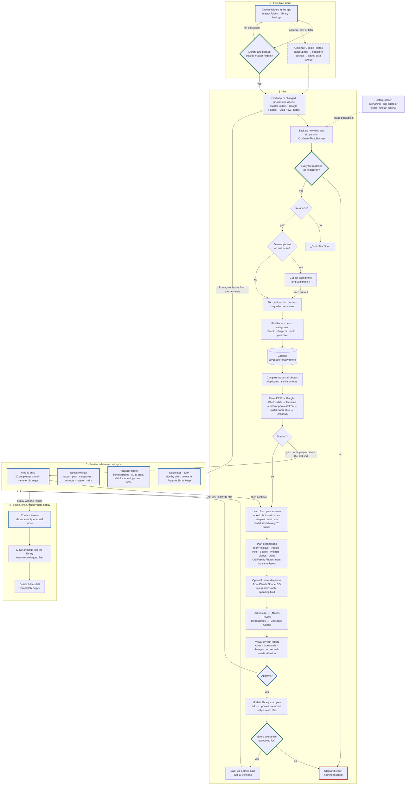

# ImageCleanuper Pipeline

How photos travel from your folders to a sorted library. Nothing is analyzed or moved until a verified backup exists, you approve every sort, and the tool gets better each round as you answer its questions.

The cycle: **First-time setup → Run → Review → Run again → … → Finish**

**Legend:** dashed border = optional, off by default · thick green border = safety gate (the run stops if it fails) · blue border = you do this · red = stop · dotted arrow = uses / reads from



A **run** is one pass over your whole collection. The first run backs up and analyzes everything, so it's slow. Later runs only handle new photos and your answers, so they take minutes.

## Library layout

```
<library>\
  2024\
    Holidays\Christmas\ · Thanksgiving\ · …
    People\Mom\ · Dad\ · Calvin\ · …
    Pets\ · Scenic\ · Projects\ · <your categories>\
    Videos\
    Other\
  Unknown Date\…
  Old Family Photos\
    1985\  (same layout as above)
    Unknown Year\…
    Original Scans\
  _Add New Photos\
  _Needs Review\
  _Accuracy Check\
  _Duplicates\
  _Junk\
  _Strangers\
  _Could Not Open\
```

A photo goes into **every** folder it belongs to (Calvin on a mountain at Christmas → `Holidays\Christmas`, `People\Calvin`, `Scenic`). Special folders start with `_` so they sort together at the top, and each has a `READ ME.txt`.

## Decided

### Safety
- **Backup before anything.** Every photo and video is fingerprinted (SHA-256) and zipped to `C:\MasterPhotoBackup` before analysis. The zip is written in parts and verified against the fingerprints; if anything fails, the run stops with nothing touched.
- **Each file is backed up once.** Later runs back up only new or changed files. Old backups are never overwritten.
- **Learned data is backed up** (names, labels, ratings, models) to `C:\MasterPhotoBackup\Learned Data\` after every run, keeping the last 10 versions.
- **Originals are never edited.** Rotation, trim and cut-outs are saved as new files. Until Finish, the library holds copies only (no hard links).
- **Crash recovery.** Results are saved after every photo, the model every 25 labels, and "last photo processed" is tracked. After a crash the app offers to continue where it stopped. Every move during Finish is logged first, so a crash mid-Finish can be completed or undone. The PC is kept awake during runs.
- **Restore screen:** restore everything, one photo or folder, or find the untouched original of any library photo. Restores are checked against the backup's fingerprints and never overwrite without asking.
- **Hand edits are detected.** If files in special folders are moved or deleted outside the app, the next run says so instead of getting confused.

### Finding photos
- **Several master folders,** set in the app and stored in `settings.ini` next to the app. Every subfolder is searched, however deeply nested. Your existing folder structure is ignored for sorting, but each file's original path is kept.
- **The library location is yours to choose**, also stored in `settings.ini`. The tool refuses a library or backup location inside a master folder.
- **Long Windows paths** are handled inside the tool (the Windows setting is left alone). Any file it still can't reach is listed in the report.
- **New photos later:** drop them into `_Add New Photos` and click Run.
- **Google Photos (optional):** Google no longer lets apps read a whole Google Photos library (API change, March 2025), so the app walks you through **Google Takeout**: a button opens Takeout with only Google Photos selected, Google emails you when the export is ready, and you choose the downloaded zips. The zips are copied into `C:\MasterPhotoBackup` and verified like everything else, then their photos become another source. Google's date for each photo (from Takeout's info files) is used, and album copies are caught as duplicates. It can be done during setup or later from Home, and repeated for newer photos.
- **`_Could Not Open`** holds corrupt or unsupported files, with a list explaining why.

### Analyzing
- **Multi-photo scans are split.** Each photo is cut out, straightened and treated as its own image. The full scan is kept in `Old Family Photos\Original Scans`.
- **Rotation and border trim** (excess white or black background) only act when very sure. Uncertain cases go to Needs Review with before and after side by side: Looks good / Undo / Rotate again.
- **Old scans are found automatically,** with no folder to point out: cut out of a multi-photo scan, made by a scanner (file info), or looking like a scanned print (paper borders, print texture, no camera info). They go to `Old Family Photos\`, with the same layout as the main library. Unsure cases go to Needs Review, and "Old scan?" is part of the accuracy check.
- **Dates:** date taken (EXIF), then Google Photos' own date (for Google imports), then a date in the filename, then the date of a similar photo, then a folder-name clue (e.g. `Grandma 1985`), otherwise Unknown. The file's modified date is never used. Scanner dates are ignored.
- **Borrowed dates** are used only when the AI is at least 95% sure the photo is from the same setting. That cutoff is tuned through "Same event?" accuracy-check pairs. Scans only borrow from other scans. Borrowed dates are marked as guesses in the report.
- **Folder-name clues** can also give a holiday (`Christmas 2015`). They're used only for undated photos.
- **Holidays:** US calendar with adjustable windows and your own custom events.
- **Videos** are sorted into `Year\Videos` by date (no face or pet detection).
- **Duplicates:** exact copies and resized or re-saved copies. The best copy (highest resolution) is sorted and the extras go to `_Duplicates`. Burst shots and edited versions are kept.
- **Categories:** People, Pets, Scenic, Projects, Other, plus a top-level `_Junk` (screenshots, memes, blurry or accidental shots). You can add your own categories in `settings.ini`, each with a description that the AI uses at first; your corrections teach it after that.

### People
- **"Who is this?" cards** show sample faces of one person at a time, 20 people per round, most frequent first. Type a name or press Stranger. The tool then finds that person in all photos, including group photos.
- **Faces are shown as close-ups** and circled in group photos, so it's always clear who's meant.
- **Strangers** go to `_Strangers`. Rename one later and they become a known person. Photos whose only faces are strangers are filed under `Other`.
- **Names** aren't case-sensitive and are stored in proper case (`Joseph Richards`, with `McDonald` and `O'Brien` handled). The name box suggests existing names, asks "Did you mean…?" for near-misses, and people can be renamed or merged.

### Learning and accuracy
- **`_Needs Review`** holds anything the tool is unsure about. Whatever it *is* sure about still gets sorted; only the unsure part waits.
- **Accuracy check** (called QA during planning; folder `_Accuracy Check`) gives blind samples of confident guesses, with random file names and one question each: faces, pets, categories, holidays, cut-outs, rotation, trim, and "Same event?" pairs. Wrong guesses become labels.
- **A rating for every person and category**, tracked round by round on a scorecard (e.g. `Calvin 97% ↑`, `Scenic 88% ↓`). The target is 95%. The accuracy check starts at 50 items and shrinks as ratings reach the target, while weak or dropping ratings get more samples.
- **Locked photos:** anything you confirm is locked automatically (or press L). Later runs never move or re-label a locked photo; disagreements count against the model's rating.
- **Best samples (★ B):** mark the clearest examples of a person or category. Later passes weight them most and use them as the reference for matching. The tool also suggests best samples for you to confirm.

### Using the app
- **Install from GitHub Releases:** a Windows `.exe` installer is built automatically by GitHub Actions for each version and posted on the repo's Releases page. The installer is small (about 50–100 MB) and adds a Start-menu shortcut. No Python or command line needed.
- **First launch downloads what's needed** (AI engine and models, roughly 300 MB) with a progress bar. Downloads are checked against known fingerprints and resume if the connection drops. After that the app works offline, apart from update checks and Claude if turned on.
- **AI engine:** ONNX Runtime with DirectML, Windows' built-in way to use the graphics card. Runs on the RTX 2070 Super with no NVIDIA toolkit to install, and falls back to the CPU if needed.
- **Updates:** the app checks GitHub for a newer release and offers to install it, keeping settings and learned data.
- **Windows warning:** the `.exe` isn't code-signed, so the first launch shows "Windows protected your PC" (More info → Run anyway). The README explains this.
- **App window** (CustomTkinter): it always shows the next step, plus Setup / Run / Review / Finish buttons, waiting-item counts, the scorecard, and a progress bar with time remaining. Settings are a form with folder pickers.
- **Visual dry-run report:** totals, a folder tree with thumbnails, what changed since last run, the scorecard, and a plain-English "Needs attention" list with buttons. Misfiled photos can be corrected right in the report. Approve and sort / Not yet.
- **Duplicate and junk screens** compare side by side with details. Delete sends files to the Recycle Bin; Keep both and Swap are also available, plus "Delete all exact duplicates".
- **Hotkeys for every action:** Enter = save, → / Space = next, ← = back, Ctrl+Z = undo, 1–9 = pick an answer, S = Stranger, N = name box, D / K / W = duplicate actions, R / U = rotation actions, L = lock, B = best sample, Esc = close, F1 = list of hotkeys. Keys are shown on buttons and can be changed in `settings.ini`.
- **One Start review button** walks through everything waiting, in a fixed order: Who is this? → Needs review → Accuracy check → Duplicates → Junk. Esc saves your place.
- **No technical words on screen:** "Accuracy check" instead of QA, "fingerprint" instead of hash, no paths to type.
- **Finish** happens once, when you're happy, and you confirm it by typing FINISH. It moves the originals into the library (fixed photos stay as their fixed versions; originals remain in the backup), then deletes folders left completely empty. Folders with anything else in them are left alone.
- **Runs locally** on Windows 11 with the RTX 2070 Super. It's free, and no photos leave the PC unless you turn on Claude.

### Claude (optional)
- **Off by default.** Turning it on opens a simple **API key popup**: a key box with Paste and Show/Hide, a **Get an API key** button that opens Anthropic's sign-up and key page in your browser, a **Set up billing** button, and **Test key**, which checks the key with one tiny request and shows ✓ or a plain-English error. **Save** stores the key in Windows Credential Manager (never in `settings.ini`); **Remove key** deletes it. Enter = Save, Esc = Cancel.
- **Default model: Claude Sonnet 5.5**, changeable in Settings.
- **Used only on items the local models are unsure about:** categories and Junk, holidays, estimating the decade of old scans, rotation, trim, cut-outs, pet or not. Anything Claude is confident about is resolved; the rest still goes to `_Needs Review`.
- **Not used for recognising who someone is.** Identifying people stays with the local face model and your answers.
- **Photos are shrunk to about 512px** before sending. A **spending limit** in Settings caps what Claude can spend, and the app shows the running cost.
- **When the limit is reached** the app pops up a notice with the amount spent and how many unsure photos are left, and three choices: **continue with the free local models** (the rest go to Needs Review), **raise the limit** and keep using Claude, or **pause the run**. If nobody answers within 5 minutes, the run continues with the free local models, so an unattended run never stalls or overspends.
- **Privacy:** photos sent to Claude go to Anthropic's servers. Everything else stays on the PC. The Settings screen says this plainly.
- **Claude's answers are scored too:** the accuracy check measures how often Claude was right, and its answers feed the learning like yours.

### Parked ideas (not in the current plan)
- **Enhance old photos** (colour/fade correction, grain removal, sharpening). Tested on a real 1980s print: rule-based settings help colour; **Claude-guided settings** (Claude looks at each photo and picks the settings, local tools apply them, about a cent per photo) gave the best result. Claude can't edit images itself. Optional local AI models would remove grain far better. Parked until the rest of the app is working; would slot in after cut-out/rotate/trim with a Keep enhanced / Use original review question.

### Not adopted
- Treating default camera dates (e.g. 1 Jan 2000) as missing: camera dates are trusted as they are.
- Dropping holiday questions from the accuracy check: they stay.

## Open questions

- None right now. Coding starts when you say go.

## Change log

1. 2026-11-14 · v1: Year / Holiday / Person sorting, face learning by grouping and naming.
2. 2026-11-14 · v2: Pets folder, Duplicates folder, copy / hard link / move setting.
3. 2026-11-14 · v3: Verified zip backup before any analysis; rotation and crop step; this flowchart.
4. 2026-11-14 · v4: US holidays; missing dates borrowed from a highly similar photo, else Unknown Date.
5. 2026-11-14 · v5: Flowchart moved to this Markdown file so it displays directly on GitHub.
6. 2026-11-14 · v6: Search all nested subfolders; existing folder structure ignored for sorting; original paths kept; name clashes get a suffix.
7. 2026-11-14 · v7: Several master folders; split multi-photo scans; trim white/black borders; scanner dates ignored.
8. 2026-11-14 · v8: Backups go to C:\MasterPhotoBackup as dated zips; backup and output folders excluded from collection.
9. 2026-11-14 · v9: Old scans go to Old Family Photos/; folder names used as date and holiday clues.
10. 2026-11-14 · v10: Needs Review/ folder; your labels retrain the models on the next run.
11. 2026-11-14 · v11: Old Family Photos/ uses the same layout as the main library.
12. 2026-11-14 · v12: Blind QA sampling with accuracy report.
13. 2026-11-14 · v13: Full design review applied: stages Setup → Run → Review → Run again → Finish; back up once; Finish step; library kept in sync; copies only (no hard links); 95% date borrowing; videos; Could Not Open; long paths; settings.ini; learned-data backup; Who is this? cards and Strangers; proper-case names; cautious rotation and trim; per-category ratings and shrinking QA; categories and Junk; duplicate screen; hotkeys; locked photos and best samples; app window; visual report; crash recovery; Restore; READ MEs and _ folders; Install.bat.
14. 2026-11-14 · v14: .exe installer built to GitHub Releases, downloads its AI files on first launch; ONNX Runtime + DirectML instead of PyTorch; optional Claude Sonnet 5.5 second opinion for unsure items, with spending limit; Install.bat dropped.
15. 2026-11-14 · v15: API key popup with Get an API key, Set up billing and Test key buttons.
16. 2026-11-14 · v16: Scans folder setting removed (scans detected automatically); Google Photos import via Google Takeout.
17. 2026-11-14 · v17: Spending-limit popup: continue with free local models, raise the limit, or pause.
18. 2026-11-14 · v18: One Start review queue; QA renamed Accuracy check (folder `_Accuracy Check`); type FINISH to confirm.
