# ImageCleanuper Pipeline

How a photo travels from your folders to the sorted library. Nothing is analyzed or moved until a verified backup exists, and you approve the plan before any file is written.

**Legend:** thick green border = safety gate (the run stops if it fails) · blue border = you decide · dashed orange = not settled yet · red = stop

```mermaid
flowchart TD
  SRC["Your master folders (several)<br/>nested any number of levels deep"]

  subgraph P0["1 · Backup first"]
    COL["Collect every image from all master folders<br/>and subfolders; record SHA-256 + original path"]
    ZIP["Zip into one archive<br/>keeps original folder paths"]
    VER{"Every file in the zip<br/>matches its hash?"}
    STOP["Stop and report<br/>nothing touched"]
    STORE["Save archive + manifest<br/>to backup location"]
  end

  subgraph P1["2 · Analyze (originals read-only)"]
    META["Read date taken<br/>EXIF → date in filename<br/>scanner dates ignored"]
    SCAN{"Several photos<br/>on one scan?"}
    SPLIT["Cut out each photo<br/>straighten, save as its own image"]
    ROT["Fix rotation<br/>EXIF orientation + sideways check"]
    TRIM["Trim excess<br/>white / black borders"]
    HASH["Fingerprint<br/>exact + look-alike hash"]
    FACE["Find faces<br/>face fingerprints"]
    PET["Pet check<br/>dog / cat"]
    NODATE{"Date found?"}
    SIM["Borrow date from a<br/>highly similar photo"]
    UNK["Unknown Date"]
    DB[("Catalog")]
  end

  subgraph P2["3 · Learn people"]
    GRP["Group similar<br/>unknown faces"]
    NAME["Name each group<br/>Mom, Dad, Calvin…"]
    LIB[("People library")]
    MATCH["Match faces<br/>to people library"]
  end

  subgraph P3["4 · Plan"]
    DUP["Duplicates<br/>keep best copy, extras → Duplicates/"]
    YEAR["Year<br/>from date taken"]
    HOL["Holiday<br/>date vs. US calendar"]
    DEST["Destinations<br/>Year/Holidays · Year/People · Year/Pets · Year/Other"]
    DRY["Dry-run report"]
    OK{"Plan looks right?"}
  end

  subgraph P4["5 · Write output"]
    OUT["Copy / hard link / move<br/>name clashes get a suffix"]
    CHK{"Every source image<br/>accounted for?"}
    LOG["Summary + log"]
  end

  SRC --> COL --> ZIP --> VER
  VER -- "no" --> STOP
  VER -- "yes" --> STORE
  STORE -- "unlocks analysis" --> META
  META --> SCAN
  SCAN -- "yes" --> SPLIT -- "each cut-out photo" --> ROT
  SCAN -- "no" --> ROT
  ROT --> TRIM --> HASH --> FACE --> PET --> NODATE
  NODATE -- "yes" --> DB
  NODATE -- "no" --> SIM
  SIM -- "match found" --> DB
  SIM -- "no match" --> UNK --> DB
  DB -- "unnamed faces" --> GRP --> NAME -- "saves" --> LIB
  LIB --> MATCH
  DB -- "all faces" --> MATCH
  MATCH -- "unsure faces held for next review" --> GRP
  MATCH --> DUP --> YEAR --> HOL --> DEST --> DRY --> OK
  OK -- "no: change settings" --> DUP
  OK -- "yes" --> OUT --> CHK
  CHK -- "no" --> STOP
  CHK -- "yes" --> LOG

  classDef gate stroke:#2f7d5b,stroke-width:4px
  classDef human stroke:#3b6fb6,stroke-width:3px
  classDef open stroke:#b7791f,stroke-width:3px,stroke-dasharray:6 4
  classDef stop stroke:#c0392b,stroke-width:3px
  class VER,CHK gate
  class NAME,OK human
  class STOP stop
```

## Decided

- **Backup before anything.** All images are collected, zipped and verified against a hash list before any analysis or moving starts.
- **Several master folders.** You list each top folder in the settings; the tool searches all of them. Duplicates are found across all of them, not just within one.
- **Your existing folders are ignored for sorting.** The tool searches every subfolder, however deeply nested, and sorts only by date, faces, pets and duplicates. Each photo's original path is kept in the catalog and in the zip, so any photo can be traced back to where it came from.
- **Name clashes:** files from different folders with the same name (e.g. many `IMG_0001.jpg`) get a suffix like `IMG_0001_2.jpg` in the sorted output.
- **Multi-photo scans are split.** When one scan holds several photos, each photo is cut out, straightened and saved as its own image, then goes through the rest of the pipeline like any other photo. The original scan stays in the backup zip.
- **Border trim:** excess white or black background around a photo is cropped off.
- **Scanner dates are ignored.** A scan's date is the day it was scanned, not when the photo was taken, so scans go straight to the similar-photo check and then `Unknown Date`.
- **Hard links:** rotated, cropped or cut-out photos are saved as normal copies; untouched photos can be hard links.
- **Originals are never edited.** Rotation and crop fixes are written to the sorted copies only. The zip keeps the untouched originals.
- **Layout:** `Year/Holidays/<holiday>`, `Year/People/<name>`, `Year/Pets`, `Year/Other`, plus `Duplicates/`. A photo goes into every folder it belongs to.
- **Output mode is a setting:** copy, hard link (one copy on disk, same drive only) or move.
- **People:** local face recognition. Faces are grouped first, then you name the groups.
- **Holidays:** US calendar (Thanksgiving, July 4th, etc.), with adjustable windows and your own custom events.
- **Missing dates:** date taken (EXIF), then a date in the filename, then the date of a highly similar photo, otherwise `Unknown Date`. The file's modified date is not used.
- **Runs locally** on Windows 11 with the RTX 2070 Super. Free; no photos leave the PC.
- **Python**, in this repo.
- **No code yet.** Coding starts only when you say so.

## Open questions

- **Backup location:** where should the zip go? A different drive from the photos (e.g. an external drive) is safest.
- **Dates for old scanned photos:** most will end up in `Unknown Date`. Is that OK, or would you rather they go in their own `Scanned/` folder, or get dated from folder names (next question)?
- **Folder names as hints:** you said your folders can *mostly* be ignored. Should a folder name like `Christmas 2015` ever be used as a clue when a photo has no date, or should folder names be ignored completely?

## Change log

1. 2026-11-14 · v1: Year / Holiday / Person sorting, face learning by grouping and naming.
2. 2026-11-14 · v2: Pets folder, Duplicates folder, copy / hard link / move setting.
3. 2026-11-14 · v3: Verified zip backup before any analysis; rotation and crop step; this flowchart.
4. 2026-11-14 · v4: US holidays; missing dates borrowed from a highly similar photo, else Unknown Date.
5. 2026-11-14 · v5: Flowchart moved to this Markdown file so it displays directly on GitHub.
6. 2026-11-14 · v6: Search all nested subfolders; existing folder structure ignored for sorting; original paths kept; name clashes get a suffix.
7. 2026-11-14 · v7: Several master folders; split multi-photo scans into separate images; trim white/black borders; scanner dates ignored; edited photos saved as copies.
