# ImageCleanuper Wireframes

What the app looks like from first launch to Finish. These are wireframes (layout and wording), not final visuals. See the [process flowchart](FLOWCHART.md) for what happens behind each screen.

## Screen flow

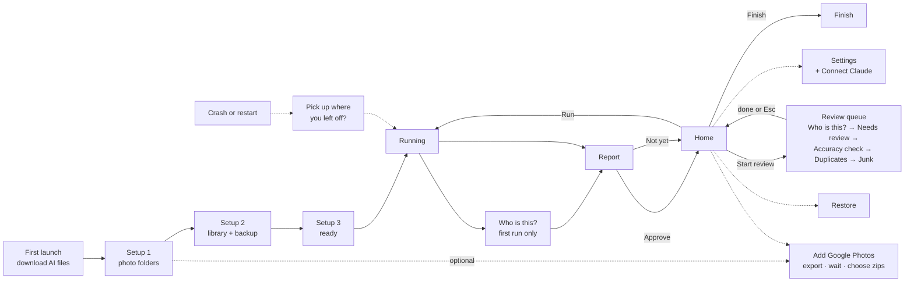

**The rule that keeps it simple:** the Home screen always shows **one Next step** with one big button. You can always just press **Enter** and the app takes you to the right place.

## Layout rules (every screen)

Every screen is built from the same four parts, so nothing is ever a dead end:

1. **Nav bar on the left** (all main screens): Home · Run (R) · Review (V) · Report (P) · Finish (F) · Restore · Settings. The current page is highlighted; Review shows how many items are waiting. While a run is working, the other pages are greyed out until you pause it. First launch, setup and pop-ups have no nav bar.
2. **Title + one line** saying what the screen is for.
3. **Middle area** that scrolls when it doesn't fit; nothing important is ever pushed off-screen. The window opens maximised and **photo previews grow to fill the space** (the sizes drawn here are the minimum).
4. **Footer pinned to the bottom:** secondary action (Back / Not yet / Cancel, Esc) on the left, the main action (Enter) on the right, and a hotkey line.

Screens are built exactly as drawn here. A screen that isn't in this document isn't built until it's added here first.

## Walkthrough

### 1. First launch
The installer is small; the AI files download once, with progress and automatic retry.

### 2. Setup: where are your photos?
Add top folders with a folder picker. No typing paths. Old scanned photos are found automatically. Optionally bring in Google Photos.

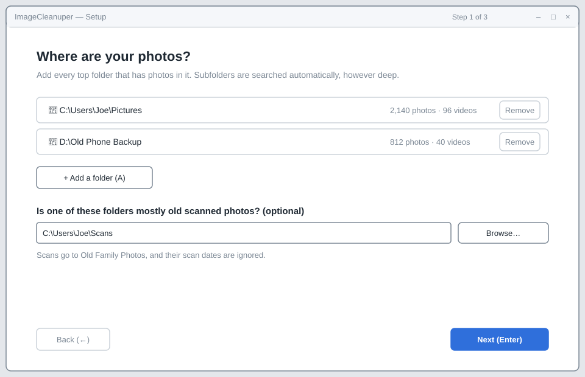

### 2b. Add Google Photos (optional, now or later from Home)
Google only allows a full-library export through Google Takeout, so the app walks you through it: request the export, wait for Google's email, then choose the downloaded zips. The zips are copied into the backup folder and checked, and Google's own date for each photo is used.

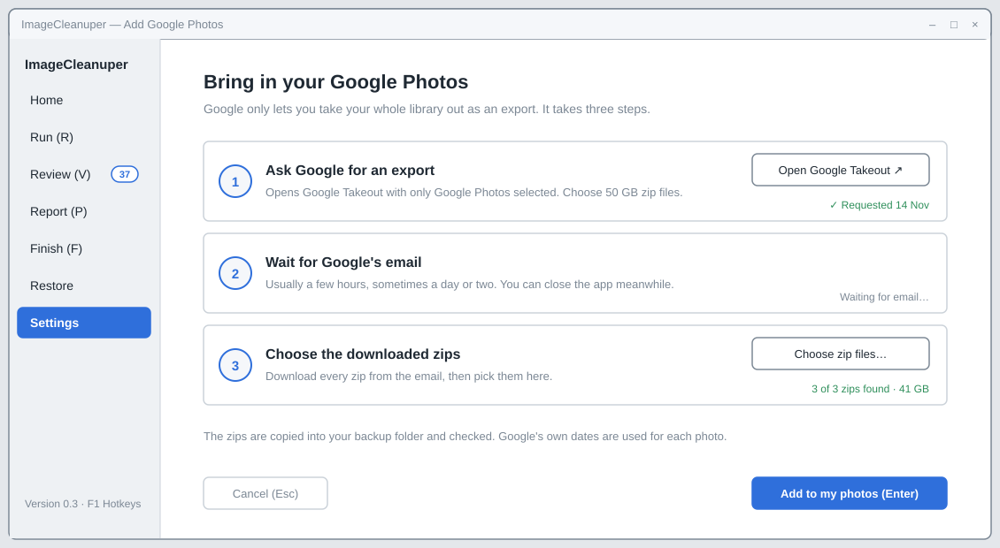

### 3. Setup: where should things go?
Library and backup locations, each checked on the spot (free space, not inside a photo folder).

### 4. Setup: ready
Explains the four things that happen next, and how long it will take, before anything starts.

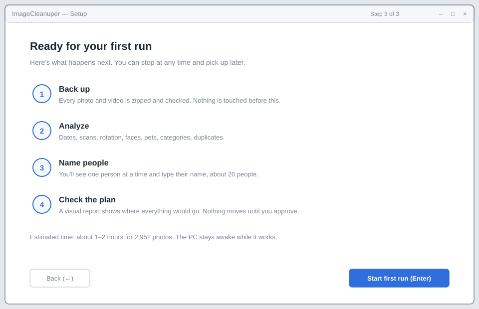

### 5. Running
One bar per stage, time remaining, and the photo being worked on. Pause any time.
Approve and sort uses this same screen with a single "Sort" bar ("Sorting into your library"), then returns to Home with a short summary.

### 6. If the PC crashes or restarts
The app offers to continue from the last photo. Nothing is lost.

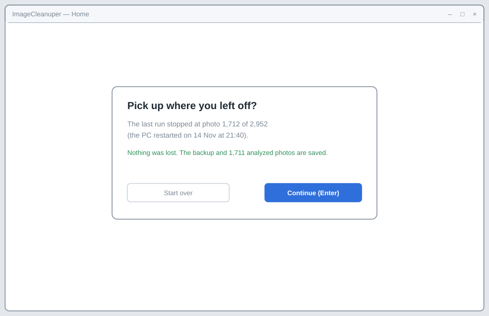

### 7. Who is this? (first run, then whenever new faces appear)
One person at a time. The app offers its **3 best guesses** (the people this face looks most like) as big buttons with **1 / 2 / 3** hotkeys; type a name only when it isn't one of them (names also auto-complete as you type), or press Stranger.

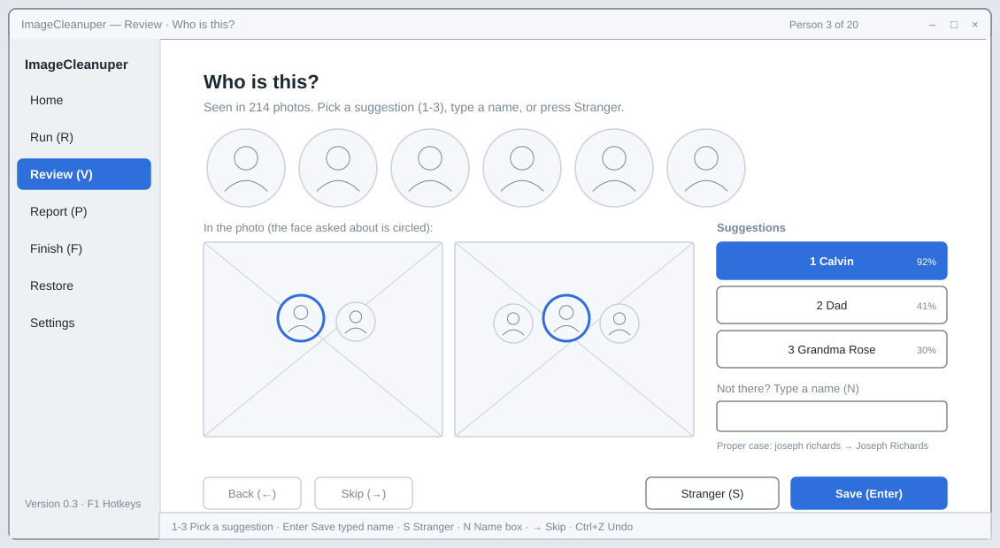

### 8. Report
Totals, a folder tree with thumbnails, a "Needs attention" list with buttons, and Approve and sort.

### 9. Home
The Next step, what's waiting for you, the accuracy scorecard, and when the last run finished. (The main actions live in the nav bar.)

### 10. Review queue
**Start review** walks through everything waiting, in this order, so you never have to choose: Who is this? → Needs review → Accuracy check → Duplicates → Junk. Press Esc any time; progress is saved.

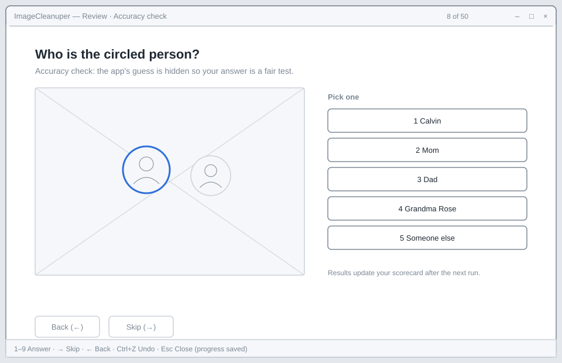

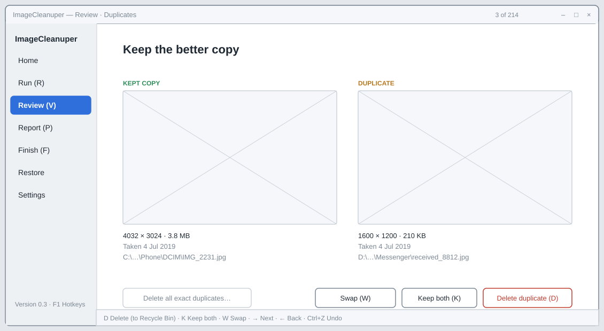

**Duplicates and burst shots** show one group at a time with every copy side by side. The app's pick is selected; press 1-9 to change it, **D** keeps the selection and removes the rest, **K** keeps all. Burst shots (same camera, seconds apart, nearly the same picture) are kept unless you choose; the sharpest is suggested. Bulk: "Do this for all groups…" with a confirmation. Removed copies leave the library at once and go to the Recycle Bin at Finish.

Junk uses the same layout, with **Delete (D)** and **Not junk (K)**.

### 11. Finish
A checklist (backup verified, accuracy), exactly what will happen, and typing FINISH to confirm.

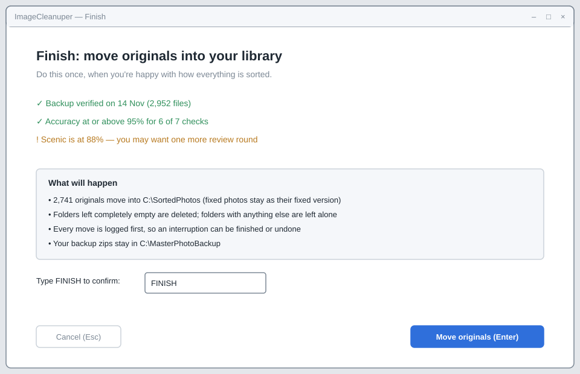

### 12. Settings and Connect Claude
Tabs for Folders, Holidays & categories, Accuracy, Hotkeys and Claude. Turning Claude on opens the API key popup.

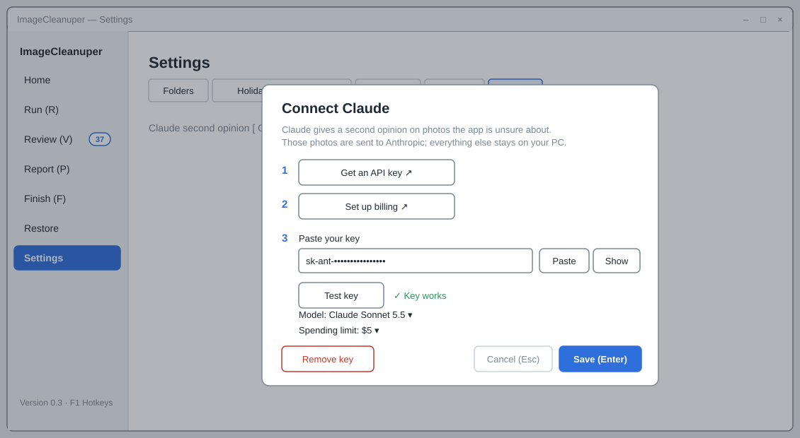

When the Claude spending limit is reached during a run, a popup offers to continue with the free local models, raise the limit, or pause. If nobody answers in 5 minutes, it continues with the free models.

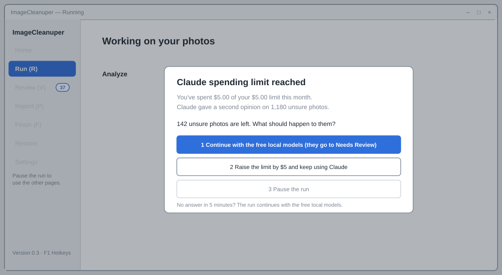

### 13. Restore
Restore everything, one photo or folder, or find the untouched original of any photo.

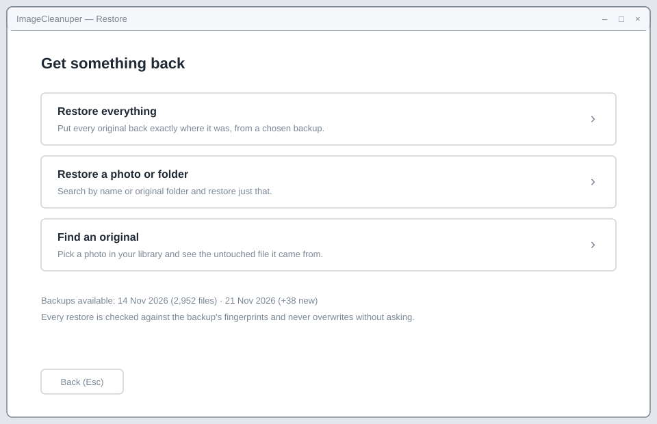

## Friendliness check

What makes it easy to follow from start to finish:

- **One next step, always.** Home tells you what to do in plain words, with one big button. Enter always does the obvious thing.
- **One review button.** Every question the app has goes into a single queue. There are no separate places to remember.
- **Nothing happens by surprise.** The backup comes first, the report before sorting, and Finish needs you to type FINISH.
- **No technical words on screen.** "Accuracy check" instead of QA, "fingerprint" instead of hash, and no file paths to type.
- **You can stop any time.** Esc closes any screen with progress saved; crashes resume.
- **Hotkeys everywhere,** shown on each button and in the bar at the bottom. F1 lists them all.
- **Everything is undoable** with Ctrl+Z, and deleted files go to the Recycle Bin.

## Change log

1. 2026-11-14 · v1: First wireframe set (13 screens) and screen flow.
2. 2026-11-14 · v2: Scans-folder option removed (scans found automatically); Add Google Photos screen.
3. 2026-11-14 · v3: Spending-limit popup.
4. 2026-11-15 · v4: Nav bar on every main screen; Home simplified (no duplicate action tiles, last run shows date/time, no run number); layout rules written down.
5. 2026-11-15 · v5: Who is this? gets 3 suggested names (1-3 hotkeys); previews grow with the window (opens maximised).
6. 2026-11-15 · v6: Duplicates redrawn as group selection (keep one or several, remove the rest, bulk); burst shots handled on the same screen.
