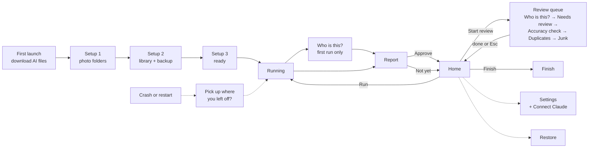
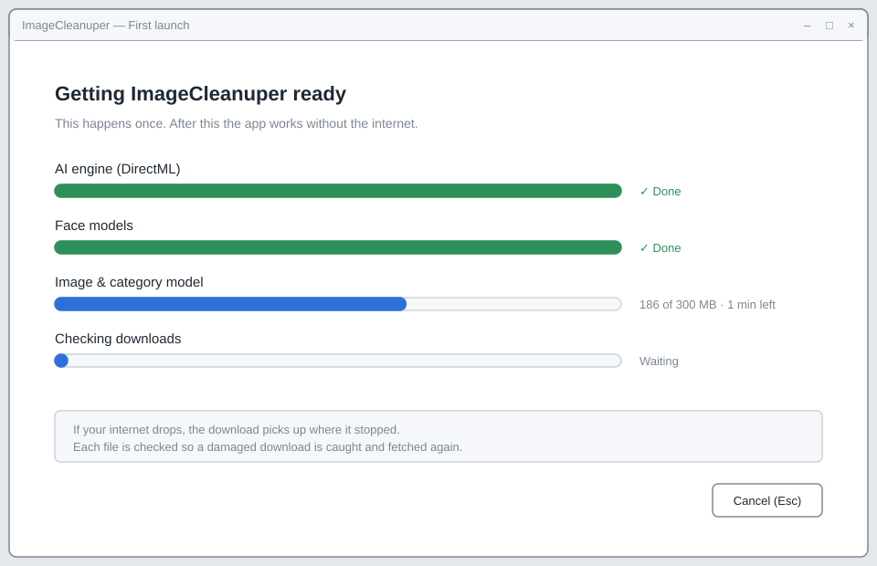
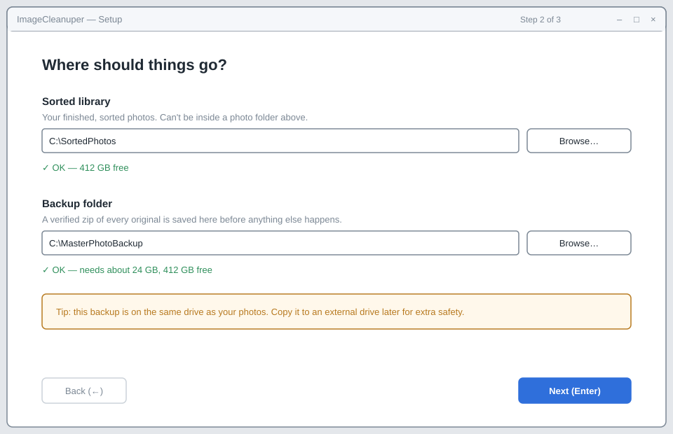
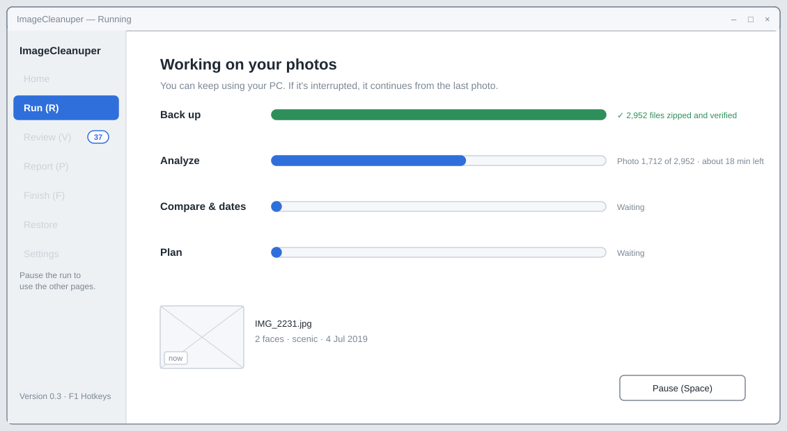
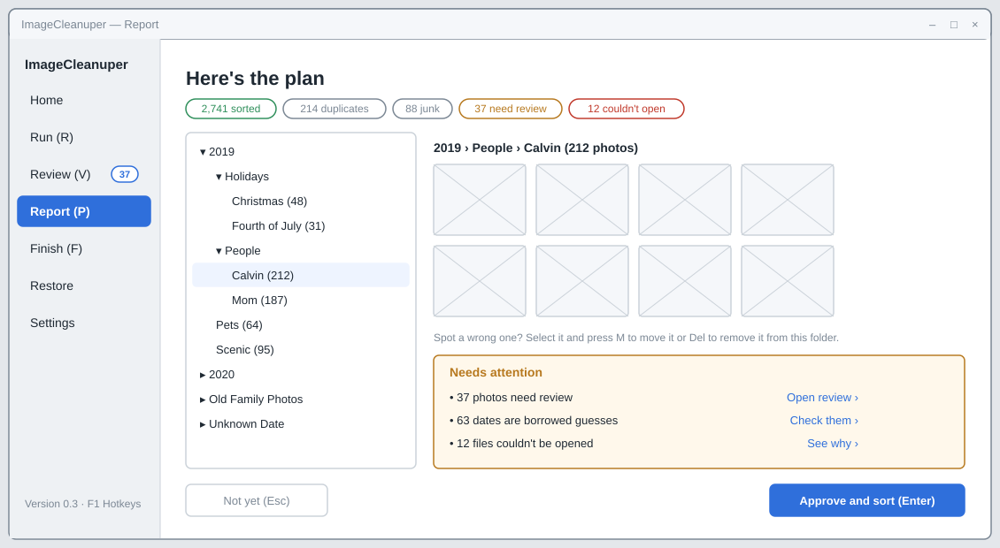
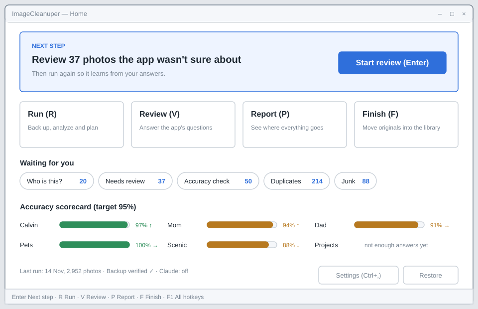
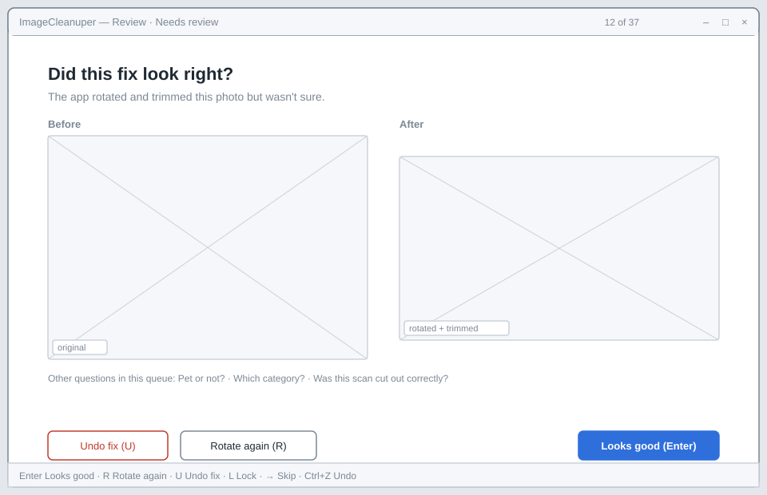

# ImageCleanuper Wireframes

What the app looks like from first launch to Finish. These are wireframes (layout and wording), not final visuals. See the [process flowchart](FLOWCHART.md) for what happens behind each screen.

## Screen flow

**The rule that keeps it simple:** the Home screen always shows **one Next step** with one big button. You can always just press **Enter** and the app takes you to the right place.

## Walkthrough

### 1. First launch
The installer is small; the AI files download once, with progress and automatic retry.

### 2. Setup: where are your photos?
Add top folders with a folder picker. No typing paths. Optionally mark a folder of old scans.

### 3. Setup: where should things go?
Library and backup locations, each checked on the spot (free space, not inside a photo folder).

### 4. Setup: ready
Explains the four things that happen next, and how long it will take, before anything starts.

### 5. Running
One bar per stage, time remaining, and the photo being worked on. Pause any time.

### 6. If the PC crashes or restarts
The app offers to continue from the last photo. Nothing is lost.

### 7. Who is this? (first run, then whenever new faces appear)
One person at a time. Type a name (suggestions appear as you type) or press Stranger.

### 8. Report
Totals, a folder tree with thumbnails, a "Needs attention" list with buttons, and Approve and sort.

### 9. Home
The Next step, the four main actions, what's waiting for you, and the accuracy scorecard.

### 10. Review queue
**Start review** walks through everything waiting, in this order, so you never have to choose: Who is this? → Needs review → Accuracy check → Duplicates → Junk. Press Esc any time; progress is saved.

Junk uses the same side-by-side layout as Duplicates, with **Delete (D)** and **Not junk (K)**.

### 11. Finish
A checklist (backup verified, accuracy), exactly what will happen, and typing FINISH to confirm.

### 12. Settings and Connect Claude
Tabs for Folders, Holidays & categories, Accuracy, Hotkeys and Claude. Turning Claude on opens the API key popup.

### 13. Restore
Restore everything, one photo or folder, or find the untouched original of any photo.

## Friendliness check

What makes it easy to follow from start to finish:

- **One next step, always.** Home tells you what to do in plain words, with one big button. Enter always does the obvious thing.
- **One review button.** Every question the app has goes into a single queue. There are no separate places to remember.
- **Nothing happens by surprise.** The backup comes first, the report before sorting, and Finish needs you to type FINISH.
- **No technical words on screen.** "Accuracy check" instead of QA, "fingerprint" instead of hash, and no file paths to type.
- **You can stop any time.** Esc closes any screen with progress saved; crashes resume.
- **Hotkeys everywhere,** shown on each button and in the bar at the bottom. F1 lists them all.
- **Everything is undoable** with Ctrl+Z, and deleted files go to the Recycle Bin.

## Change log

1. 2026-11-14 · v1: First wireframe set (13 screens) and screen flow.
